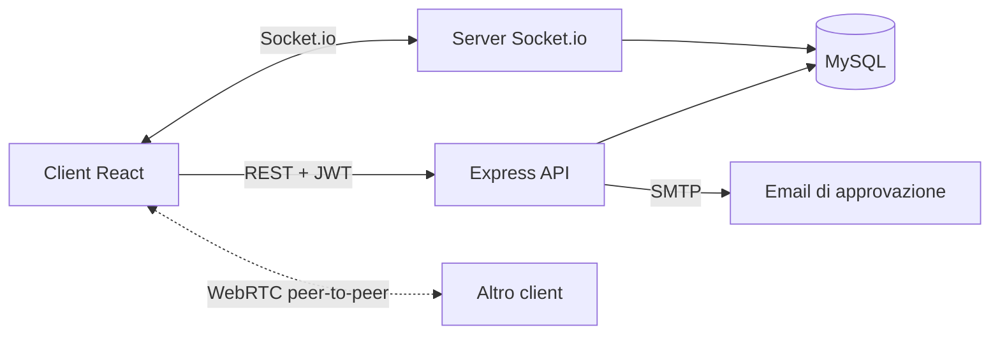

<div align="center">

# 💬 Messaggistica Istantanea

**Chat in tempo reale con registrazione su approvazione, presenza utenti e videochiamate 1 a 1.**


</div>

---

## ✨ Panoramica

Applicazione full stack pensata per una community chiusa: nessuno può iscriversi in autonomia, ogni richiesta di registrazione passa dall'approvazione di un amministratore, che riceve una password temporanea via email e deve cambiarla al primo accesso.

Una volta dentro, gli utenti vedono chi è online, si scrivono in tempo reale, tengono traccia dei messaggi non letti e possono avviare una videochiamata direttamente dal browser.

<!--
Per aggiungere le schermate: salva le immagini in docs/screenshots/ e decommenta le righe qui sotto.

## 🖼️ Anteprima

| Chat | Pannello admin |
|---|---|
|  |  |
-->

## 🚀 Funzionalità

| | |
|---|---|
| 🔐 **Accesso controllato** | Registrazione su richiesta, approvazione o rifiuto da parte dell'admin, password temporanea via email e cambio obbligatorio al primo login |
| 💬 **Chat privata live** | Messaggi istantanei con Socket.io, cronologia degli ultimi 30 messaggi e anteprima dell'ultima conversazione |
| 🔔 **Non letti** | Contatore per ogni conversazione, azzerato all'apertura della chat |
| 🟢 **Presenza** | Stato online/offline aggiornato in tempo reale per tutti gli utenti |
| 📹 **Videochiamate** | Chiamate 1 a 1 con WebRTC: invito, accettazione, rifiuto e termine |
| 👤 **Profilo** | Nome, username, telefono, indirizzo e immagine modificabili |
| 🛠️ **Pannello admin** | Gestione delle richieste, creazione ed eliminazione degli utenti |

## 🧱 Architettura



La segnalazione delle videochiamate passa dal server Socket.io; audio e video viaggiano poi direttamente tra i due browser.

## 🛠️ Tecnologie

| Area | Stack |
|---|---|
| Backend | Node.js, Express, Socket.io, MySQL (`mysql2`), bcrypt, JSON Web Token |
| Frontend | React 19, Vite, Axios, Socket.io Client |
| Database | MySQL 8, charset `utf8mb4` |
| Tempo reale | Socket.io, WebRTC |
| Email | SMTP |

## ⚡ Avvio rapido

**Requisiti:** Node.js 20 o superiore e MySQL 8 in esecuzione.

### 1. Database

Dalla root del progetto:

```bash
mysql -u TUO_UTENTE -p < database/database.sql
```

Crea il database `messaggistica_db` con le tabelle `users`, `user_status` e `messages`.

### 2. Backend

```bash
cd Backend
npm install
cp .env.example .env     # inserisci i tuoi valori
npm run dev
```

### 3. Frontend

```bash
cd Frontend
npm install
npm run dev
```

### 4. Primo amministratore

Le registrazioni richiedono l'approvazione di un admin, quindi il primo va inserito una volta nel database, con la password hashata con bcrypt:

```sql
INSERT INTO users (email, password_hash, first_name, last_name, username, role, status)
VALUES ('admin@esempio.it', '<hash-bcrypt>', 'Admin', 'Sistema', 'admin', 'admin', 'approved');
```

## ⚙️ Variabili d'ambiente

Definite in `Backend/.env` (modello in `Backend/.env.example`).

| Variabile | Descrizione |
|---|---|
| `PORT` | Porta del server |
| `CLIENT_URL` | Indirizzo del frontend, usato per CORS (HTTP e Socket.io) |
| `JWT_SECRET` | Chiave per firmare i token (lunga e casuale) |
| `DB_HOST`, `DB_PORT`, `DB_USER`, `DB_PASSWORD` | Connessione a MySQL |
| `DB_NAME` | Deve coincidere con il database creato (`messaggistica_db`) |
| `SMTP_HOST`, `SMTP_PORT`, `SMTP_USER`, `SMTP_PASS` | Server SMTP per le email di approvazione |
| `MAIL_FROM_NAME`, `MAIL_FROM_EMAIL` | Nome e indirizzo mittente delle email |

## 🗄️ Database

```
users ──┬── user_status   (1 a 1: stato online/offline, ultimo accesso)
        └── messages      (1 a N: mittente e destinatario)
```

| Tabella | Contenuto |
|---|---|
| `users` | Anagrafica, ruolo (`user` / `admin`), stato della richiesta (`pending` / `approved` / `rejected`), flag di cambio password |
| `user_status` | Stato di presenza e data dell'ultimo accesso |
| `messages` | Messaggi privati con flag di lettura |

Eliminando un utente vengono eliminati a cascata anche i suoi messaggi e il suo stato.

## 🔌 API REST

| Metodo | Endpoint | Accesso | Descrizione |
|---|---|---|---|
| POST | `/api/registration-requests` | Pubblico | Invia una richiesta di registrazione |
| POST | `/api/auth/login` | Pubblico | Login, restituisce il token |
| POST | `/api/auth/logout` | Utente | Logout |
| PATCH | `/api/auth/status` | Utente | Aggiorna il proprio stato |
| PATCH | `/api/auth/change-password` | Utente | Cambia la password |
| GET | `/api/users` | Utente | Elenco utenti approvati |
| GET / PUT | `/api/users/me` | Utente | Legge o modifica il proprio profilo |
| POST | `/api/messages` | Utente | Invia un messaggio |
| GET | `/api/messages/:receiverId` | Utente | Ultimi 30 messaggi della conversazione |
| GET | `/api/messages/unread-counts` | Utente | Messaggi non letti per mittente |
| GET | `/api/messages/last-message/:userId` | Utente | Anteprima dell'ultimo messaggio |
| PATCH | `/api/messages/read/:senderId` | Utente | Segna i messaggi come letti |
| `*` | `/api/admin/...` | Admin | Richieste (elenco, approva, rifiuta) e utenti (elenco, crea, elimina) |

## 📡 Eventi Socket.io

| Evento | Direzione | Scopo |
|---|---|---|
| `register_user` | client → server | Associa il socket all'utente e lo segna online |
| `user_status_changed` | client → server | Aggiorna lo stato |
| `user_status_updated` | server → tutti | Notifica il nuovo stato di un utente |
| `join_private_chat` | client → server | Entra nella stanza privata di due utenti |
| `send_private_message` / `receive_private_message` | bidirezionale | Invio e ricezione dei messaggi |
| `call_user` / `incoming_call` | bidirezionale | Invito alla videochiamata |
| `accept_call` / `call_accepted` | bidirezionale | Accettazione |
| `reject_call` / `call_rejected` | bidirezionale | Rifiuto |
| `webrtc_offer`, `webrtc_answer`, `webrtc_ice_candidate` | bidirezionale | Segnalazione WebRTC |
| `end_call` / `call_ended` | bidirezionale | Termine della chiamata |
| `disconnect` | automatico | Rimuove il socket e segna l'utente offline |

## 🔒 Sicurezza

- Password hashate con **bcrypt**; le password temporanee sono generate con `crypto` (casualità crittografica)
- Autenticazione **JWT** a scadenza e rotte protette da middleware, con controllo del ruolo per l'area admin
- **Limite ai tentativi di login**: 20 ogni 15 minuti per indirizzo, con `express-rate-limit`
- **CORS limitato** all'indirizzo del frontend, anche per Socket.io
- Query SQL **parametrizzate**, contro le SQL injection
- Nessun dettaglio interno negli errori restituiti al client: l'errore reale resta nel log del server
- Credenziali in `.env`, escluso dal repository

## 📁 Struttura del progetto

```
.
├── database/
│   └── database.sql          # schema MySQL
├── Backend/
│   └── src/
│       ├── config/           # connessione al database
│       ├── controllers/      # logica delle richieste
│       ├── middleware/       # autenticazione e ruoli
│       ├── routes/           # definizione degli endpoint
│       ├── utils/            # invio email
│       └── server.js         # avvio, API e Socket.io
└── Frontend/
    └── src/
        ├── pages/            # Login, Registrazione, Chat, Profilo, Admin
        ├── services/         # chiamate API
        └── styles/           # CSS dei componenti
```
